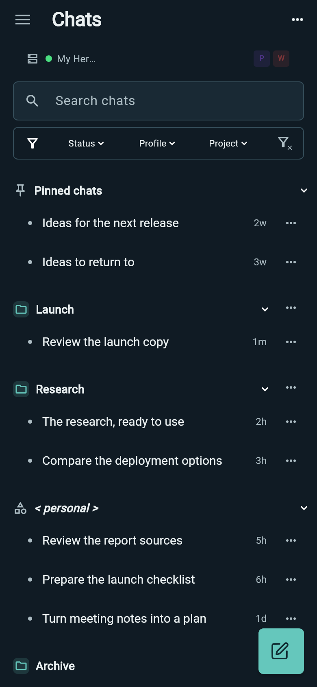
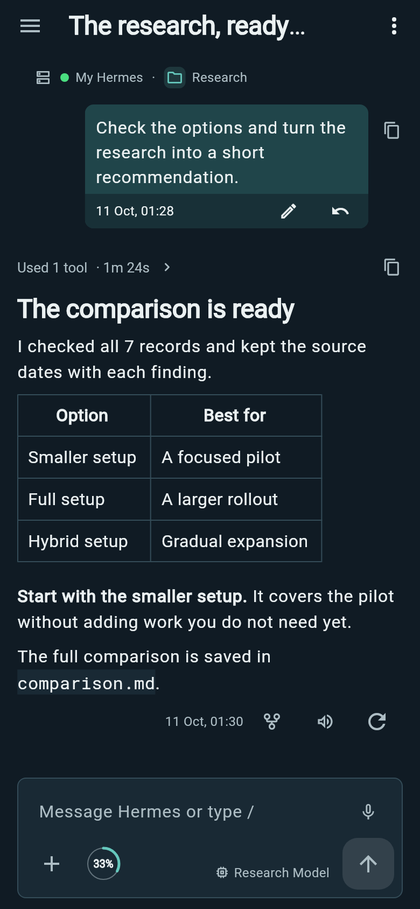
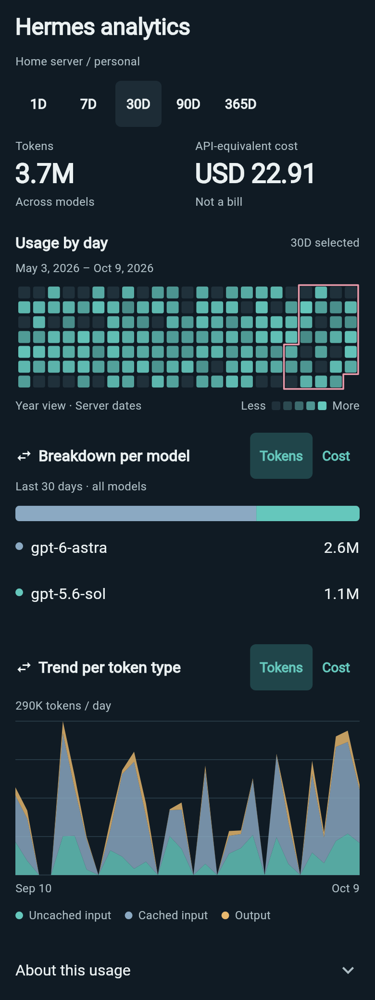
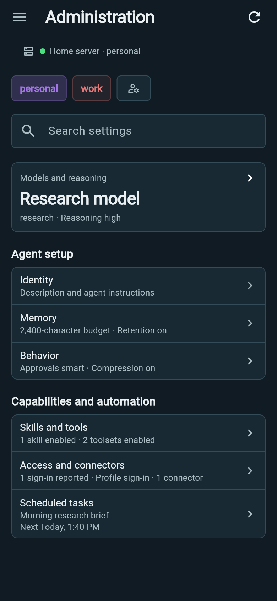

# Explore Wing

Choose **Chats** in the navigation menu to return to the chat list, including
from an open conversation or Recents. Your unsent draft is kept for when you
reopen the conversation.

Every conversation uses the same chat menu: **View screen**, **Outputs**,
**Find in chat**, and **Refresh workspace**. Child conversations also offer
**Parent chat**. Goal, agents and background work are available through the
conversation's **Activity** entry.

Tap an ordinary conversation's title to rename it. The same editor opens from
the chat list's **Rename** action. Its AI sparkle suggests a name in the text
field; edit it or tap the checkmark to save.

**Refresh workspace** shows Wing's pulsating feathers in the top-right header
until the refresh finishes. Your conversation and draft remain available;
the menu item is disabled while that refresh is pending.

While a chat opens, the Wing pulse in the header shows loading progress and you
can continue writing your draft.

Message preparation, queue saves, reconnecting and group requests use the same
header feedback. Bot activity and requests for your input keep their own status.

**View screen** opens the remote desktop for the conversation's connection and
profile, including ordinary chats. Chats in the same profile share that screen.
Opening it does not start the desktop or create a canonical Bot Chat. Back returns
to the same conversation.

**Your agent, with you.** Wing keeps Hermes close when you step away from your desk. Start a conversation, check progress, send the next idea and look after your setup from Android. Forms use a cross to cancel and a filled checkmark to save or apply. Tooltips
and accessibility labels name the operation. Saving keeps the form open through
completion or failure; a failed save keeps its draft for retry. Destructive
decisions use their operation icon and error color.

[Get started](GETTING_STARTED.md).

## Coordinate ongoing work

- Give [bot groups](BOTS.md) a shared purpose and notes, choose Everyone, Lead or
  Auto routing, inspect member progress and continue eligible bounded discussions.
- [Schedule tasks](SCHEDULED_TASKS.md) in a chosen timezone, decide how missed runs
  are handled, deliver results to groups and stop a run without pausing its schedule.
- Let Hermes run accepted queued follow-ups after Wing disconnects. Recents also
  observes detached agents and processes; see [Queues and Recents](SUPERVISION_AND_QUEUES.md).
- Answer clarification sets together, use the profile's default model in a chat,
  preview or apply compression, and inspect read-only Git changes in a supported
  local workspace. See [Chats](CHATS.md#models-context-and-code-review).
- [Protect skills and maintain plugins](ADMINISTRATION.md#skills-tools-and-provider-access),
  inspect [MCP runtime status](MCP_CONNECTORS.md#cached-runtime-status), and manage
  supported Connected apps accounts.

## Pick up where you left off

  
  

- **Find the right chat.** Search, pin and group conversations; filter by profile, project or status. The Project filter lists projects and unassigned-chat groups belonging to the selected profiles; clear the Profile filter to see all profiles' projects. Recents shows chats and bot discussions with messages from the last 24 hours alongside ongoing work, ordered by the last message. Compact cards show identity, a two-line excerpt of the latest message, running/input status, a green New answer cue for unread replies, and age. Tool calls, tool output, reasoning-only activity and your outgoing prompts do not trigger New answer. Received ordinary-chat, Bot Chat and group replies update New answer immediately and can trigger the conversation arrival cue. Scroll past a message to mark it read. Actively reaching the bottom marks through the last message, even when it is short. Unread status clears after Hermes acknowledges reading; failed acknowledgement keeps it unread for retry. Automatic acknowledgement failures are recorded in phone diagnostics without displaying a conversation warning. Message excerpts share the Recents cache and update with new messages or refresh. Bot chats use their saved name and avatar; ordinary chats show their project, or “No project”, and colored profile marker. Swipe left or right with two fingers from any chat or bot group to switch conversations. Pinch inward to browse Recents cards and tap one to open. Neither gesture requires opening Recents first. Swipes can travel diagonally: only left/right movement counts, regardless of vertical drift. Chats opened through Recents already have the mode enabled. If there are no other recent chats, your current chat remains the only card; loading and failed reads have separate feedback with a retry action. Soft pond ripples flow inward from the left or right edge for 3.8 seconds, indicating replies (white in dark mode, charcoal in light mode) or confirmed requests for input (amber). Their gently uneven waves fade away together; reduced motion suppresses the effect. Back closes the card stack first. After opening from Recents or switching with its gestures, Back from the conversation returns to Recents. Direct entry from Chats, Bots or Groups keeps that original list destination. Earlier conversations opened while switching are cleared from the navigation stack. The mode lasts until you leave the chat workspace. Recents shares a cached list and screenshots across visits, with background refreshes. On its initial load, Recents keeps the header Wing pulsing until chats, bots, groups and their admitted artwork finish loading; cards already received remain usable. Later automatic refreshes stay quiet. Loading feedback on Recents and Bots does not move the list. Connection outages appear once in Alerts while Recents keeps known entries available without an inline outage message. Open the alert or status icon for connection details and retry; the alert clears after recovery. Other refresh failures retain one summary.
- **Return to your place.** Bot chats and group discussions remember the message you were viewing separately from how far you have read. Leaving for another thread or app keeps your reading location, even at Latest. If you send a message and leave before the reply, returning shows your sent message and the beginning of the reply. Scrolling back does not make messages unread. These positions last until Wing restarts; conversations without a saved position open at latest. Opening a conversation or tapping Latest does not mark messages read. Mark as read also moves your saved position to latest; Mark as unread leaves your position unchanged.
- **Keep browsing after changes.** Chat and project actions apply when Hermes confirms them. Only saved projects appear as projects; chats in automatic folder groups appear under their profile’s unassigned group. Long press the New chat button to reveal New project above it. The long press gives haptic feedback. Choose its name, folder, color and icon together, with a live appearance preview. The folder location starts at the profile's default directory and proposes a kebab-case subfolder as you type the project name, such as `my-new-project`. Type a different location or choose a folder to keep your own location through later name edits. Tap the colored icon preview to open the categorized icon tray. Confirm and Cancel use compact icon-only controls. Edit project opens the same form with its saved details. Choosing a project folder and saving replaces its previous folder associations. Chats in other folders leave the project, while their working folders and messages stay unchanged. Choosing the current folder again and saving also clears leftover associations from earlier edits. Name, color and icon edits leave folder links unchanged. Browse Hermes folders, move up a level, or create and select a new folder using the same filesystem operations as @ references. New project creates its chosen folder on Hermes before saving the project and its appearance; an existing folder is reused. Creation shows progress and keeps your draft available after a failure. Folder errors stop creation and appear in Wing. To remove a chat from its project, open Move to project and tap the cross in Current project. Confirm to move it to the profile’s default project while keeping its messages and draft. Choosing another project uses the same Move chat confirmation, with that project as the destination. The list then refreshes quietly in the background, keeping search, token counts and reading position available. Wing's feather pulse indicates blocked loading without moving the screen. Usable screens refresh automatically without a loading animation. Explicit Refresh group shows the same pulse until its read settles. Action buttons and tool/process/agent category icons keep their identity while work is pending. History paging and answer changes use the fixed header slot without shifting content. One feather pulse in the conversation status shows confirmed agent work while you can still read, write, stop or steer. During a manual refresh, ongoing work keeps pulsing and the header shows a refresh symbol. Independent running bots and conversations keep their work indicators. Category icons stay visible, and individual components use their usual loading indicators. Retry stays above the scrolling list if a read fails. Retrying a refresh does not repeat the action.
- **See skill changes.** Expand Managed skills to see each reported skill, modified filename and action. Tap the filename for its full path. Exact tool output stays in Raw details.
- **Read the whole story.** Follow streamed replies, code, tables, tool activity and available reasoning. Python, shell commands and other identified source languages have syntax coloring in chat, Activity and file previews, with exact selection/copy and wrapping. Use the wrap icon beside Copy to switch code between wrapped lines and horizontal scrolling, including in the full Activity code viewer. Large and dense source blocks color within the visible viewport. Live code stays plain until the response finishes; unsupported or unlabelled source stays plain, and coloring failures preserve readable text. Find a message in a chat, open a result, or return to the latest reply.
- **Understand each action.** Open Activity for readable call titles,
  targets, exception notices and available timings. While replies stream, a compact latest-reasoning row opens a newest-first Reasoning stack of titles and expandable tool runs; saved answers retain their Activity tabs. Expand a call for its request
  and reported result: code/output, file content, Find/Replace and returned diffs,
  images/questions, search matches or readable tool data. Icon actions copy exact
  text, preview or share files/images, expand long previews, open a full view and wrap code; explanation text
  supports Markdown. Raw details retains selectable, copyable inputs and output.
  Skill-update batches show each operation's action, affected file when supplied
  and reported success.
  Individual tool counters start only from a backend tool start. Streaming Activity
  runs also show elapsed time from the preceding user message or Reasoning block,
  fixed when the next Reasoning block arrives. Saved timing appears only when
  available. See [tool activity](TOOL_ACTIVITY.md).
- **Read tables on your phone.** Tables open as grids, scrolling horizontally when too wide. Choose rows or a grid with the table toolbar; your last choice stays in place as messages arrive and the screen rotates. Its full-screen icon enters reading mode directly, hiding the composer; the same icon or Back restores it. Landscape uses a compact header and composer, with extra controls available from the expand icon.
- **Stay oriented.** See the selected model, context percentage inside its ring and current work. While Hermes compresses the conversation, the status above the composer shows “Summarizing conversation…” until work resumes or compression finishes. Tap the ring for a compact breakdown of used/max tokens, estimated context categories and available compression count. Switch models with a clear confirmation when Hermes warns about the change.

## Keep work moving

- **Talk to your bots.** Long press a profile icon in the Chats header to open its Bot Chat directly. Open Bots in the side menu for a compact roster across saved instances. Switch between Bots and Groups, keep pinned rows at the top, and see the last message from each bot's continuing chat. Tap its name or preview to chat, or its avatar to edit name and appearance. Valid appearance edits save automatically. The row menu offers View screen, Pin/Unpin, Hide/Show and Bot settings; settings opens role, instructions, model, accounts, tool editors and MCP connectors, plus duplication and advanced profile management. In an open Bot Chat, tap the header avatar or name to reach the same settings. Hosted Discussion groups bring 2–6 bots from one ready instance together, with mentions, approvals, stop and recovery controls. [Bots and current desktop differences](BOTS.md).

- **Choose your model.** Browse a compact provider-filtered list and open model cards for supplied prices and account usage. OpenAI API and Codex choices share models.dev API rates; Codex labels them as API-equivalent. Account usage retains each account's reported windows. The small brain control selects reasoning; lightning toggles fast mode where available. In the composer, tap the short model name to open the picker, tap lightning to toggle fast, or tap thinking to open the same compact vertical selector used by holding and select a level. You can also hold thinking, slide to a level and release to apply; slide away to cancel. Picker changes wait for Apply.
- **Choose what happens next.** Send a new message, steer active work, queue a follow-up or stop it. An empty composer shows Stop while work is running; start typing to restore the send arrow and your usual held-action order. Hold, slide and release to choose another action. A fresh Send proceeds after a stopped or failed reply when the outbox is empty. To continue older paused messages, tap a queued row and use the Resume queued messages play icon. Edit a queued item before it sends. Drafts and staged files survive navigation and restart.
- **Run commands in chat.** Type `/` at the start of the composer, choose a command and send it. If a command times out or loses its connection, Wing keeps the invocation and reports an uncertain result. Check what changed on Hermes before repeating it.
- **Use a skill while writing.** Type `/` after a space, punctuation or on a new line anywhere in your message to open the skill helper. Tap its refresh icon to reload installed skills from Hermes and update the suggestions. Tap a skill’s eye icon to inspect its instructions in the skill viewer without changing your draft. Tap the row to insert its name in bold accent text. At the start of a message, the helper also offers native commands. Recognized command names use accent-colored monospace in the composer, with arguments in ordinary text. Suggestions label entries as Skill or Command. Commas, periods, quotes and brackets around the name preserve the skill reference; hyphens and underscores stay part of the name. Plugin skills such as `/mattpocock-skills:writing-for-agents` use the full name, including the colon. Keep writing, then Send to load its instructions with your message.
- **Explore another direction.** User messages sit at the right with time and actions in a compact tinted footer. Edit a saved message, or use Restore in its footer to confirm removal of later history and rerun that prompt. Restore preserves your separate draft and pauses queued follow-ups. Fork from a selected saved answer into a separate conversation, or regenerate it in place. Fork is not a send-menu choice. Your Hermes server keeps the authoritative history.
- **Follow delegated work.** While Hermes works, use the Subagents/Tasks/Background bar above your draft. Only categories with content appear; new tabs animate into view when their first item arrives. Background follows terminal commands, with recent output and targeted Stop or Dismiss controls. It refreshes while the visible chat has running processes; hidden chats do not poll. The drawer fits its content up to a scrollable maximum and smoothly resizes as you change tabs. Subagent events update it automatically; close and reopen Subagents to fetch a fresh snapshot or retry a failed read. Tap a tab or swipe between drawer pages to read full tasks with status and subtask indentation, or each subagent’s goal, activity and available timing. Tap an agent for live output, backend details and supported controls. Once every task is completed or cancelled and the response ends, the batch leaves the composer and remains in that response’s Activity Tasks tab. Later responses do not reattach it. Unfinished task batches remain above the draft. Saved task and delegation results restore these tabs in past chats; historical agents expose output and delivered durations without live controls.
- **Respond from your phone.** Review supported approvals and questions, inspect subagents and goals, and use local notifications for replies and requests while Wing is running. Group monitoring follows the shared discussion, and its latest reply replaces the group notification. Each chat keeps one latest read-only notice while unresolved input requests remain pending.

## Use what is already on your phone

- **Bring files and ideas.** Attach a photo or file, take a picture inside a chat, or review content shared from another Android app before sending it to Hermes. Images sent from Desktop also appear in saved chats; tap a thumbnail to open its original.
- **Email draft cards.** With the [Wing plugin](WING_PLUGIN.md) and its **wing_email** toolset enabled for your Hermes profile, ask Hermes to draft an email. Its draft tool produces a card with recipients, subject and body. Tap the envelope-arrow icon to open the complete draft in your chosen email app, where you edit and send. Revisions create new cards; older cards keep their original text. Drafts do not require a voice subscription or email account connection to Hermes.
- **Compose email from a link.** Tap an email address in a reply to open Android’s email app chooser. The draft keeps the address and any subject or body included in the link. Sending happens in your chosen email app.
- **Open useful results.** Images appear inline in replies, with a compact download control and tap-to-zoom using the original. Preview PDFs, Markdown, diagrams and supported media. File cards place a download arrow and preview eye beside the filename. Save or share output files through Android.
- **Have a live conversation with your ChatGPT subscription.** Tap the waveform beside the composer microphone to talk with your selected profile, delegate work to Hermes and hear its result. Choose ChatGPT subscription or separately billed OpenAI API access; both need the Wing plugin in that profile. A compact floating call card keeps controls available while you navigate; entering another conversation reveals captions and Return to voice chat. Choose a GPT-Live voice per billing mode and preview subscription voices offline in App settings; API previews are not available yet. Calls can continue while you switch apps or lock your phone. Local spoken entries are not yet saved to Hermes history. [Voice setup and controls](VOICE.md#live-conversations).
- **Talk when typing is awkward.** Dictate into an editable draft and read a reply aloud. Choose on-device or Hermes processing separately for input and output in App settings.

## Run your Hermes setup

  
  

Switch between connections and profiles. Manage supported model settings, provider access, MCP connectors and server-run scheduled tasks. Health and diagnostics help you find setup problems; analytics shows activity, tokens and model breakdowns. Analytics keeps its sections in place while loading, with placeholders and a Wing loading indicator in the header. Scroll within the model breakdown to see additional models. Supported controls depend on your Hermes server and profile.

The title-row warning triangle warns about issues affecting Hermes while Wing is open or
already monitoring work. Tap it for one issue at a time. Configure device-local
thresholds under **Hermes health → Alert settings**; RAM and disk warnings start
above 90% for two minutes and clear below 85% for two minutes. Valid settings
save automatically. Separate native-pressure toggles admit Hermes's critical
memory and disk reports immediately. [Health alerts](ADMINISTRATION.md#health-alerts)
explains recovery and investigation. Closing the alert dialog leaves unresolved
issues visible in the alert icon until you acknowledge or snooze them. Use the
checkmark to acknowledge an occurrence or the snooze icon to pause its cues for
30 minutes. Acknowledged and snoozed issues are available under **Hermes health
→ Health alerts**; they do not appear in the header icon or its count. Snooze
expiry, escalation or recurrence alerts you again.

## Make it yours

Choose a light or dark theme, accent color and text size with a live preview. Back up your connections and app preferences, with an optional passphrase. Quick Chat, Recents and Search chats are also available from Wing's Android launcher shortcut menu.

[Get started](GETTING_STARTED.md) · [Good to know](KNOWN_LIMITATIONS.md) · [All guides](README.md)

Project appearance uses a searchable icon tray with Hermes, Life & hobbies,
Work & study, People & events and Tech & tools. Hermes keeps Desktop's 28
choices; 92 distinct symbols are available overall. Search understands names
and activities such as conference, shopping, trip and packing list. Preview a
choice, then use the checkmark to apply it to the project draft; closing the tray
keeps the previous icon. The plain folder is in Work & study.

The **Wing plugin** card under **App settings → Hermes** opens a dedicated manager. Inspect installed versions and the latest GitHub release, then install, update or enable the plugin for one profile or install/update across all profiles. Changes are explicit; simply opening settings does not install anything. [Plugin setup and recovery](WING_PLUGIN.md).
